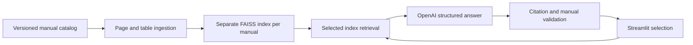

# Motorcycle Manual Assistant

Motorcycle Manual Assistant is a local, evidence-based RAG application for motorcycle owners and mechanics. It answers English questions from one selected owner's manual, cites the supporting excerpt, and lets the user inspect the original PDF page. When the selected manual does not establish an answer, the assistant asks for missing context or says it could not confirm the information.

## Available manuals

| Motorcycle | Manual identity | Pages | Catalog status |
|---|---|---:|---|
| Yamaha Ténéré 700 World Raid | XTZ690D Owner's Manual, first edition, April 2022 | 114 pages | Model year 2022- Current; Europe and UK|
| Voge 500DS | English Owner's Manual, first edition, January 2020  | 75 pages | Model year: 2020 - 2024 |

Manual PDFs are local files and are not distributed by this repository or Docker image. The Yamaha file contains an explicit restriction on unauthorized reproduction; redistribution permission for both files is unconfirmed. Obtain copies legally and place them at the paths in `configs/manuals.yaml`. The catalog validates their SHA-256 hashes before use.

## Architecture



Indexes are prepared by the maintainer and reused at application startup. The app never creates embeddings silently. Vector data is stored in FAISS and metadata in JSON, without pickle loading. See [architecture](docs/architecture.md), [evaluation](docs/evaluation.md), and [security and privacy](docs/security-and-privacy.md).

## Local setup

Python 3.9 is the supported target.

```powershell
python -m venv .venv
.\.venv\Scripts\Activate.ps1
pip install -r requirements.lock
Copy-Item .env.example .env
```

Add `OPENAI_API_KEY` to `.env`, then validate the local manuals and build both indexes:

```powershell
$env:PYTHONPATH="src"
python -m rag_genai_core.cli validate-catalog
python -m rag_genai_core.cli build-index --manual all
```

Start the application:

```powershell
streamlit run apps/streamlit_app.py
```

If an index is missing or its PDF/configuration fingerprint changed, the UI shows the exact maintainer command needed to rebuild it.

On Windows networks with managed TLS inspection, export the trusted Windows roots and point the app to the resulting local bundle:

```powershell
python scripts/export_windows_ca.py artifacts/windows-ca.pem
$env:MMA_CA_BUNDLE="artifacts/windows-ca.pem"
```

## Docker

The image intentionally excludes PDFs, indexes, and credentials.

```bash
docker build -t motorcycle-manual-assistant .
docker run --rm -p 8501:8501 \
  --env-file .env \
  -v "$(pwd)/docs:/app/docs:ro" \
  -v "$(pwd)/artifacts:/app/artifacts" \
  motorcycle-manual-assistant
```

Build indexes on the host first, or run the CLI in a container with the same mounts.

## Example behavior

For the Yamaha manual, a supported answer can take this form:

> The specified drive-chain distance A is 40.0-45.0 mm (1.57-1.77 in). Check it with the motorcycle on its sidestand, in neutral, and with no weight on the motorcycle. [S1]

`[S1]` expands to the exact excerpt, physical PDF page, optional printed page, and an original one-page PDF. The wording shown here is documentation, not a recorded live-model result.

## Add a manual

1. Obtain the manual legally and keep it under `docs/` without committing it.
2. Inspect its identity, language, edition, market, text layer, tables, and page numbering.
3. Add a complete catalog record with explicit `unknown` values and the file SHA-256.
4. Add extraction tests for any tables whose meaning depends on row or column position.
5. Run `validate-catalog`, build its index, and add human-checked evaluation cases.

## Quality checks and evaluation

```powershell
ruff check apps src tests scripts
pytest -q --basetemp=.pytest_tmp
python scripts/evaluate.py --validate-only
python scripts/evaluate.py --split development
python scripts/evaluate.py --split all --generation
```

The standard test suite uses simulated embeddings and generation and makes no paid calls. Live evaluation is opt-in. The dataset contains 48 human-checked cases: 32 development and 16 reserved. Reports include sample size, per-case failures, retrieval Recall@k and MRR, response status, required terms, citations, latency, and token counts when available.

The initial 48-case live baseline measured Recall@6 at 95.12% and MRR at 0.680 over 41 evidence-labeled cases. Expected-status accuracy was 62.50%, required-term accuracy was 64.58%, and citation-page accuracy was 79.17% among answered labeled cases. It exposed 13 pipeline errors and 20 critical case failures; 67,237 input and 1,623 output tokens were reported. The resulting citation, ambiguity, and follow-up fixes pass offline tests but have not received a second paid evaluation. See the [baseline report](evals/reports/baseline-summary.md) for scope and limitations.

## Data sent to OpenAI

Index construction sends extracted manual chunks to the configured embeddings model. Each question sends the question, retrieved excerpts, and limited recent history to the configured generation model. PDFs, indexes, API keys, and full conversations are not logged by the application.

## Limitations

- Answers are limited to the available manual edition and can still be incomplete or misinterpreted.
- The Voge source has uneven English and conflicting oil figures: a 2.7 L replacement fill volume and a 3.2 L parameter-table capacity. The assistant must preserve that distinction or ask for clarification.
- Printed page numbers are recorded only when extraction identifies them safely; physical PDF page numbers are always retained.
- No OCR, internet supplementation, motorcycle comparison, autonomous diagnosis, authentication, or public deployment is included.
- Evaluation measures a finite sample and is not a universal accuracy guarantee.

## Roadmap

Retrieval changes such as hybrid search or reranking should be considered only after comparing them against the same reviewed evaluation set for quality, latency, cost, and maintenance. OCR should be added only for a manual with a demonstrated missing or unusable text layer.
