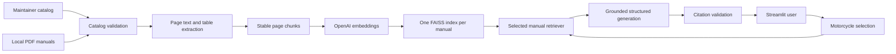

# Architecture

The catalog is the source of truth. Indexes are separated by `manual_id`, so retrieval cannot cross motorcycle boundaries. Each index directory is addressed by a fingerprint of the PDF hash, parser and table rules, chunk settings, and embedding model. The application loads only a complete, compatible directory.

PyMuPDF supplies ordered text, table cells, page rendering, and one-page PDF exports. Tables are appended to page text in a row-preserving representation before page-local chunking. FAISS stores normalized vectors; chunk metadata is JSON. No pickle is loaded.

The core package has no Streamlit dependency. UI session state owns the limited conversation history and discards it whenever the motorcycle changes.
